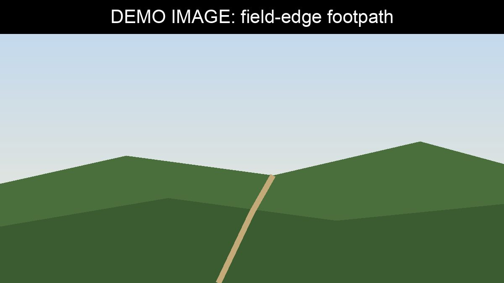

Many of the parish's paths have not been surveyed for over ten years. Several
local residents, Mr Bennet among them, have mentioned that some stiles are hard
to climb and some signs have disappeared.

The survey will:

- record the condition of every path surface, stile, gate and bridge
- note missing or damaged signs
- photograph any problems, so they can be reported accurately

