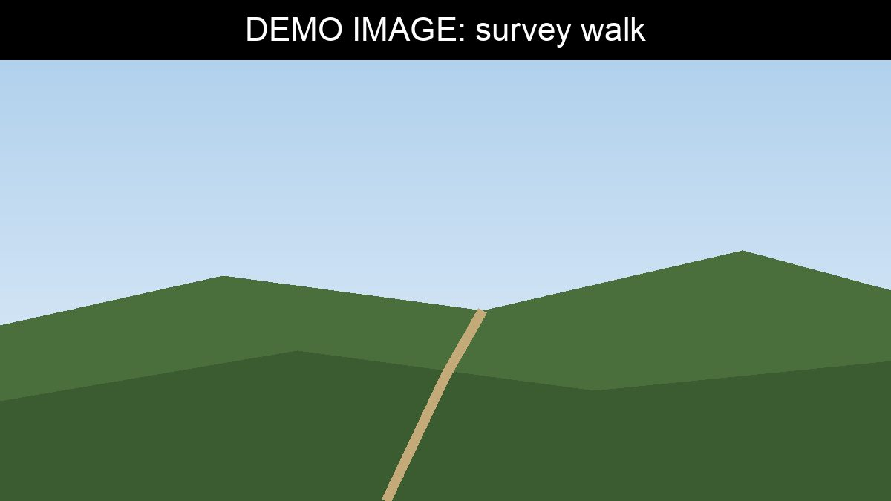

Led by Elizabeth Bennet, this project is surveying the whole footpath network
around the (fictional) village of Longbourn. Volunteers walk each path, record
problems and take photographs, so the forum can give the county council a clear
picture of where work is most needed.

## How to take part

We welcome volunteers of all abilities. Download the
[survey form (PDF)](files/survey-form.pdf), or read more
[about the survey](background.md).
