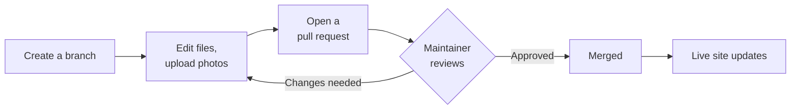

# Editing guide

How forum members update the website using GitHub in a web browser. No software to install and no web skills needed.

## How changes reach the website

Changes are never made directly to the live site. Instead:

1. You make your changes on a **branch**: your own working copy of the site, separate from the live version.
2. When you are happy, you open a **pull request**, asking for your changes to be added to the live site.
3. The site maintainer **reviews** your changes and either merges them or asks for something to be adjusted.
4. Once merged, the live site updates itself within a couple of minutes.



Nothing you do on a branch can break the live site, so feel free to experiment.

## Before you start

You need:

1. **A GitHub account.** Sign up free at [github.com](https://github.com/).
2. **Access to the website's repository.** Send your GitHub username to the site maintainer, who will invite you. Accept the invitation from the email GitHub sends you, or from your GitHub notifications.

Bookmark the repository page. All the forum's content is in the `demo_content` folder (or `content` once the real site is live). To check which, open `_config.yml` and look at the `collections_dir:` line.

## Words you will see

| Word | Meaning |
|---|---|
| Repository (repo) | The website's files on GitHub |
| `main` | The branch that is published as the live site |
| Branch | A separate working copy where you make changes |
| Commit | Saving a change. Each commit has a short description |
| Pull request (PR) | A request to add your branch's changes to the live site |
| Merge | Adding approved changes to `main`, which updates the live site |

## The basic steps

Every change follows the same four steps. The examples below follow this pattern.

### 1. Create a branch

1. Open the repository on GitHub.
2. Near the top left, select the button showing **main** (the branch menu).
3. Type a short name for your change, such as `longbourn-survey-update`. Use lower case and hyphens, no spaces.
4. Select **Create branch: longbourn-survey-update from main**.

The branch menu now shows your branch's name. **Check it shows your branch, not `main`, before every change.**

### 2. Make your changes

While on your branch:

| To | Do this |
|---|---|
| Edit a file | Open the file, select the **pencil** icon, make your changes, then **Commit changes** |
| Create a file | Open the folder, **Add file** > **Create new file**. Typing `/` in the name creates a folder |
| Upload photos or PDFs | Open the folder, **Add file** > **Upload files**, drag files in, then **Commit changes** |
| Delete a file | Open the file, select **...** > **Delete file**, then **Commit changes** |

When you commit, GitHub asks for a short description (the suggested one is fine) and where to commit. Choose **Commit directly to the `your-branch-name` branch**.

You can make as many changes on one branch as you like before the next step.

### 3. Open a pull request

1. Go to the repository's main page. A yellow banner says your branch had recent pushes. Select **Compare & pull request**.
   If there is no banner, select the **Pull requests** tab, then **New pull request**, and choose your branch in the **compare** menu.
2. Give the pull request a clear title, such as "Longbourn survey: October update and photos".
3. In the description, say briefly what you changed and why.
4. Select **Create pull request**.

The maintainer is notified automatically.

### 4. Respond to the review

You will get an email when the maintainer responds.

- **Approved and merged:** nothing more to do. Your changes are on the live site within a couple of minutes. GitHub may offer to **Delete branch**; select it to tidy up.
- **Changes requested:** read the comments on the pull request. Switch to your branch (step 1, but choose your existing branch from the menu), make the changes, and commit. The pull request updates automatically; you do not need a new one. Add a comment saying you have made the changes.

### Checking your changes before review

The live site only shows `main`, so you cannot see your branch as a web page. In the pull request, select **Files changed** to see exactly what you have changed. For Markdown files, select the **document** icon at the top of a file to see it formatted, with images, rather than as text.

## Common tasks

Paths below start from the content folder (`demo_content/` or `content/`).

### Post a project update

Updates are short news items. They appear on the project's page, on the Projects page, and on the home page.

1. Create a branch.
2. Open `_current/projects/<project-name>/updates/`.
3. **Add file** > **Create new file**, named with the date and a few words: `2026-11-15-gates-installed.md`.
4. Type:

   ```markdown
   ---
   title: Two new gates installed
   date: 2026-11-15
   ---
   A few sentences of news. Keep it short; link to the project's
   other pages for detail.
   ```

5. Commit, then open a pull request.

### Edit a project page

1. Create a branch.
2. Open `_current/projects/<project-name>/` and the page to change: `index.md` is the project's main page; other `.md` files are its extra pages.
3. Select the pencil icon and edit the text below the `---` lines.
4. Commit, then open a pull request.

### Add photos to a project

1. Create a branch.
2. Open `_current/projects/<project-name>/images/`.
3. **Add file** > **Upload files**, drag in your photos, and commit.
   Use short file names in lower case with hyphens, such as `new-gate.jpg`. Resize large photos to about 1,600 pixels wide first if you can.
4. Edit the page where the photo should appear and add:

   ```markdown
   
   ```

   The description is read aloud by screen readers, so describe what the photo shows.

If the project has no `images` folder, upload the photos to the project's own folder instead, and leave out `images/` in the link: ``.
5. Commit, then open a pull request.

### Add a document to a project

As for photos, but upload to the project's `files/` folder and link to it with:

```markdown
[Survey report, October 2026 (PDF)](files/survey-report.pdf)
```

### Add a page to a project

1. Create a branch.
2. Open `_current/projects/<project-name>/` and **Add file** > **Create new file**, named e.g. `findings.md`.
3. Type:

   ```markdown
   ---
   title: Survey findings
   order: 3
   ---
   The page text.
   ```

   `order` sets the page's position in the project's list of pages.
4. Commit, then open a pull request. To link to it from another page of the project, use `[Survey findings](findings.md)`.

### Start a new project

1. Create a branch.
2. Open `_current/projects/` and **Add file** > **Create new file**, named `<project-name>/index.md`, e.g. `church-lane-path/index.md`.
3. Type:

   ```markdown
   ---
   title: Church Lane Path
   summary: One sentence describing the project, shown in lists and on the map.
   started: "2026-11"
   ---
   Describe the project here.
   ```

4. To put it on the map, draw its area at [geojson.io](https://geojson.io/), select **Save** > **GeoJSON**, rename the downloaded file to `area.geojson`, and upload it to the project's folder.
   Or add markers for individual places; see the example in `_current/projects/` or ask the maintainer.
5. Commit, then open a pull request.

### Add meeting papers

1. Create a branch.
2. For a new meeting, open `_current/meetings/` and **Add file** > **Create new file**, named `<date>/index.md`, e.g. `2027-04-21/index.md`:

   ```markdown
   ---
   date: 2027-04-21
   time: "10:00"
   venue: Where the meeting is held
   ---
   ```

3. Open the meeting's folder and upload the papers. Name the agenda `agenda.pdf` and the minutes `minutes.pdf`; other PDFs are listed by their file name.
4. Commit, then open a pull request.

### Update a member's profile

1. Create a branch.
2. Open `_current/members/<member-name>/profile.md` and edit it. To change the photo, upload a new `photo.jpg` to the same folder; it replaces the old one.
3. Commit, then open a pull request.

### Close a project or record a member leaving

These involve moving a folder from `_current` to `_archive`, which is awkward in the web editor. Open a pull request that adds `ended: "YYYY-MM"` to the project's `index.md` (or `left: "YYYY-MM"` to the member's `profile.md`), and ask the maintainer in the description to move the folder.

## Writing tips

- **The lines between `---` markers** at the top of each file are settings. Keep the format exactly: the setting name, a colon, a space, then the value. Put quotes around values containing a colon, and around months like `"2026-11"`.
- **Paragraphs:** leave a blank line between them.
- **Headings:** start a line with `## `.
- **Lists:** start each line with `- `.
- **Links:** `[text people see](address)`. For other parts of the site, start the address with `/`, e.g. `[our members](/members/)`.
- **File names:** lower case, hyphens instead of spaces, no special characters.
- GitHub's [Markdown guide](https://docs.github.com/en/get-started/writing-on-github/getting-started-with-writing-and-formatting-on-github/basic-writing-and-formatting-syntax) covers more formatting.

## For the maintainer

### Reviewing a pull request

1. Open the pull request from the email or the **Pull requests** tab.
2. Select **Files changed**. Check the text, the settings between `---` markers, file names, and that photos have descriptions. Use the document icon to see Markdown formatted.
3. Leave comments on specific lines if needed, then select **Review changes** and choose:
   - **Approve**, then **Merge pull request** > **Confirm merge** on the **Conversation** tab, or
   - **Request changes**, explaining what is needed.
4. After merging, check the **Actions** tab shows a green tick, then look at the live page. A red cross means the site could not be built and the previous version is still live; the run's log names the file at fault.
5. Select **Delete branch** to tidy up.

When a member asks for a folder to be moved to the archive, do it on their branch before merging, using `git mv` on a local copy or [github.dev](https://github.dev) (press `.` on the repository page).

### One-off setup

These settings make GitHub enforce the review process, so changes cannot reach the live site without approval.

**Invite members:** **Settings** > **Collaborators** > **Add people**, and enter each member's GitHub username. On a personal account, collaborators can create branches and pull requests. On an organisation account, add members to a team with **Write** access instead.

**Require review before merging:**

1. **Settings** > **Rules** > **Rulesets** > **New ruleset** > **New branch ruleset**.
2. **Ruleset name:** `Protect live site`. **Enforcement status:** **Active**.
3. **Bypass list:** add **Repository admin**, so the maintainer can still make urgent fixes and merge their own changes.
4. **Target branches:** **Add target** > **Include default branch**.
5. Under **Branch rules**, tick:
   - **Restrict deletions**
   - **Block force pushes**
   - **Require a pull request before merging**, with **Required approvals** set to **1** and **Require review from Code Owners** ticked
6. Select **Create**.

**Automatic review requests:** the file `.github/CODEOWNERS` lists who reviews every pull request. It currently names `@StephDriver`. When the site moves to an organisation, change it to the reviewing team, e.g. `@your-forum/website-reviewers`, so reviews do not depend on one person.

With these in place, when a member edits a file GitHub only offers to commit to a branch and open a pull request, not to commit directly to `main`.
