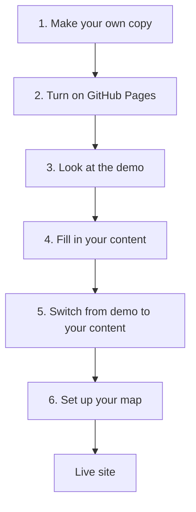

# Getting started

This guide is for a Local Access Forum that wants its own copy of this website. It takes you from nothing to a live site with your own content. You do not need web development skills; you need a GitHub account and about an hour.

## What you will end up with

- A website at `https://<your-account>.github.io/<repo-name>/`, or later on your own domain.
- Pages for your forum, members, meetings (with agendas and minutes), projects, and a map.
- Everything edited through GitHub in your web browser. There is nothing to install.



## Before you start

You need:

- **A GitHub account.** Sign up free at [github.com](https://github.com/).
- **Ideally, a GitHub organisation for your forum.** Forum members change, so the website should not belong to one person's account. A free organisation lets several members share ownership. Create one from your profile picture menu, then **Your organizations** > **New organization** (choose the free plan). If you start on a personal account you can transfer the site to an organisation later.

### How editing works on GitHub

You will use four actions throughout this guide:

| To | Do this |
|---|---|
| Edit a file | Open the file, select the **pencil** icon, make your changes, then select **Commit changes** |
| Create a file | Open the folder, select **Add file** > **Create new file**. Typing a `/` in the file name creates a new folder |
| Upload photos or PDFs | Open the folder, select **Add file** > **Upload files**, drag the files in, then select **Commit changes** |
| Delete a file | Open the file, select the **...** menu, then **Delete file** |

Each change is called a *commit*. GitHub asks for a short description of the change; the suggested one is fine. Every commit is kept, so mistakes can always be undone.

## 1. Make your own copy

1. Open the original repository on GitHub.
2. Select **Use this template** > **Create a new repository**.
3. Choose the **owner** (your forum's organisation if you have one) and a **repository name**, such as `laf-website`. The name becomes part of the web address.
4. Choose **Public**. GitHub Pages is only free for public repositories.
5. Select **Create repository**.

If there is no **Use this template** button, use **Fork** instead. It works the same way for this guide.

## 2. Turn on GitHub Pages

1. In your new repository, select **Settings**, then **Pages** in the left-hand menu.
2. Under **Build and deployment**, set **Source** to **Deploy from a branch**.
   Do not choose "GitHub Actions"; the site is designed to use GitHub's built-in build.
3. Under **Branch**, choose **main** and **/ (root)**, then select **Save**.
4. Wait a minute or two. The **Actions** tab shows progress: a run called *pages build and deployment*. A green tick means it has finished.
5. Return to **Settings** > **Pages**. Your site's address is shown at the top.

From now on, **every change you commit rebuilds the site automatically**. It takes a minute or two to appear.

## 3. Look at the demo

Open your site's address. You will see the demo: a fictional forum whose members, meetings and projects are named after characters in Jane Austen's *Pride and Prejudice*, with a yellow banner saying it is a demo.

Have a look around. The demo shows every feature working, so it is a useful reference while you fill in your own content.

## 4. Fill in your content

The repository contains two content folders:

| Folder | What it is |
|---|---|
| `demo_content/` | The demo. Currently published. Leave it alone and use it as a reference. |
| `content/` | A blank starter for your forum. Not published yet. This is where your content goes. |

Only one content folder is published at a time, so you can work on `content/` without anything appearing on the live site.

Look for **CHANGE ME** in the starter files; each marks something to replace.

### Site settings

Edit `content/_data/site.yml`:

| Setting | What to put |
|---|---|
| `name` | Your forum's full name. Shown at the top of every page |
| `short_name` | A short version of the name |
| `description` | One or two sentences. Search engines show this under your site's name |
| `area` | The county or area the forum covers |
| `email` | The address people should use to contact the forum |
| `demo` | Leave as `false` |
| `map` | See [6. Set up your map](#6-set-up-your-map) |

Keep the layout of the file exactly as it is: each setting on its own line, a colon after the setting name, and the same indentation.

### Pages

Edit each file in `content/_general/`:

| File | Page |
|---|---|
| `home.md` | Home page introduction |
| `about.md` | About the forum |
| `members.md`, `meetings.md`, `projects.md`, `map.md` | The introduction at the top of each of those pages. The lists and the map are added automatically |
| `contact.md` | Contact details |
| `accessibility.md` | Accessibility statement. Update the date at the bottom |

Each file starts with a few lines between `---` markers. Leave these as they are, apart from the `title`. Write the page text below them in [Markdown](https://docs.github.com/en/get-started/writing-on-github/getting-started-with-writing-and-formatting-on-github/basic-writing-and-formatting-syntax): a blank line between paragraphs, `## ` at the start of a heading, `- ` at the start of a list item, and `[link text](address)` for links.

To change the menu, edit `content/_data/navigation.yml`.

### Members, meetings and projects

Each member, meeting and project is a **folder** holding its text and all of its photos and files. Current ones go in `content/_current/`; when a member leaves or a project finishes, its folder moves to `content/_archive/`, keeping a public record.

The starter includes one example of each. The examples contain `published: false`, so they never appear on the site; copy them when adding your own.

**To add a member:**

1. Open `content/_current/members/example-member/profile.md` and copy its text.
2. Go back to `content/_current/members/` and select **Add file** > **Create new file**.
3. Name it `jane-smith/profile.md` (use the member's name, in lower case, with hyphens).
4. Paste the text, delete the comment lines starting with `#` and the `published: false` line, and fill in the details.
5. Commit, then open the new `jane-smith` folder and upload their photo, named `photo.jpg`.

**To add a meeting:** the same, in `content/_current/meetings/`, naming the folder after the date, e.g. `2027-04-21/index.md`. Upload `agenda.pdf` before the meeting and `minutes.pdf` afterwards. Any other PDFs in the folder are listed too.

**To add a project:** the same, in `content/_current/projects/`, e.g. `river-path/index.md`. Then:

- Put photos in an `images` folder and documents in a `files` folder inside the project's folder.
- Add more pages by creating more `.md` files in the project's folder, each with a `title`.
- Post news by adding files to an `updates` folder, named with the date, e.g. `updates/2027-05-01-survey-starts.md`. Copy the format from `example-project/updates/`.
- To put the project on the map, draw its area at [geojson.io](https://geojson.io/), save it as `area.geojson`, and upload it to the project's folder.

**When you have added your own**, you can delete the `example-...` folders or keep them as a reference. They are never published either way.

## 5. Switch from demo to your content

When you are ready for your content to go live:

1. Open `_config.yml` (in the top level of the repository) and select the pencil icon.
2. Find these two lines near the top:

   ```yaml
   collections_dir: demo_content
   data_dir: demo_content/_data
   ```

3. Change `demo_content` to `content` on **both** lines:

   ```yaml
   collections_dir: content
   data_dir: content/_data
   ```

4. Commit the change. A minute or two later, your site shows your content.

To switch back to the demo at any time, reverse the change. Nothing in either folder is lost.

You can keep `demo_content/` in the repository; it is never published unless you switch to it. It is useful for showing the forum what a fully populated site looks like.

## 6. Set up your map

### Centre and zoom

In `content/_data/site.yml`, set `map: centre:` and `zoom:` so the map opens on your area:

1. Open [openstreetmap.org](https://www.openstreetmap.org/) and move the map so your area fills the screen.
2. The address bar ends with `#map=ZOOM/LATITUDE/LONGITUDE`, for example `#map=10/51.80/0.62`.
3. Enter these as `centre: [51.80, 0.62]` and `zoom: 10`.

The map works without any rights-of-way data, showing your project areas and markers.

### Rights of way

To show footpaths and bridleways, you need your highway authority's rights-of-way data. This is a one-off technical task, so it is worth asking someone with GIS or web skills to help.

1. **Find the data.** Many councils publish it as open data. [rowmaps](https://www.rowmaps.com/datasets/) lists what each council provides, with links and licence details.
2. **Check the licence** allows publication on a website (the Open Government Licence does) and note the attribution it requires.
3. **Convert it** to a single GeoJSON file in WGS 84 (latitude and longitude), with these properties on each path:

   | Property | Example |
   |---|---|
   | `type` | `Footpath`, `Bridleway`, `Restricted Byway` or `Byway` |
   | `number` | `107` |
   | `parish` | `Waltham Abbey` |
   | `district` | `Epping Forest` |

   Simplify the lines slightly (a 2 metre tolerance works well) to keep the file small. `demo_content/_general/map/README.md` describes how the demo's Essex data was prepared.
4. **Upload it** as `content/_general/map/rights-of-way.geojson`, with a `README.md` beside it recording the source and licence.
5. **Turn it on** in `content/_data/site.yml`:

   ```yaml
   rights_of_way: /map/rights-of-way.geojson
   rights_of_way_attribution: >-
     Rights of way &copy; Your County Council. Contains public sector information
     licensed under the <a href="https://www.nationalarchives.gov.uk/doc/open-government-licence/version/3/">Open Government Licence v3.0</a>.
     Contains OS data &copy; Crown copyright and database right 2026.
   ```

## Optional: use your own domain

To use an address like `www.yourlaf.org.uk`, add it in **Settings** > **Pages** > **Custom domain**, then add the DNS record GitHub shows you with whoever manages your domain. GitHub's guide: [Managing a custom domain for your GitHub Pages site](https://docs.github.com/en/pages/configuring-a-custom-domain-for-your-github-pages-site/managing-a-custom-domain-for-your-github-pages-site).

## If something goes wrong

| Problem | What to check |
|---|---|
| The site has not changed | Wait two minutes and refresh. Check the **Actions** tab for a run in progress |
| The **Actions** tab shows a red cross | The site could not be built, and the previous version is still live. Open the run to see which file caused it. The usual cause is a mistake in the `---` section at the top of a file or in a `.yml` file: a missing colon, wrong indentation, or a value containing a colon that needs quotes around it |
| A page is missing | Check the file ends in `.md`, starts with the `---` lines, and does not contain `published: false` |
| A photo or PDF does not show | Check the file name matches exactly, including capital letters and the extension (`.jpg` is not `.JPG`) |
| Links or styles are broken on the whole site | Add `baseurl: /<repo-name>` on its own line in `_config.yml` |
| Something else | Undo your last change: open the file, select **History**, find the previous version, and copy its text back |

## Further reading

- `README.md` (top level of the repository): quick reference for common tasks.
- `docs/editing-guide.md`: how forum members update the site through branches and reviewed pull requests, and how to set up the review rules. Give this to members once the site is running.
- `docs/site-design.md`: how the site is built and why, for anyone with web skills.
- `docs/credits-and-licences.md`: the software and data the site uses, and the credits they require. Check it if you change the map data.
