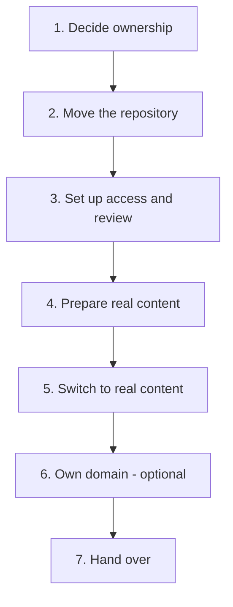

# Go-live checklist

Steps to take **if the forum decides to adopt this site**, to turn the demo into the forum's real website. None of this is needed while the site is a demo.

Work through the sections in order. Each step links to the guide with fuller instructions where one exists.



## 1. Decide ownership

- [ ] Agree with the forum who will own the website and who will review changes. Aim for at least two reviewers, so the site does not depend on one person.
- [ ] Decide whether the site should have its own domain (e.g. `www.yourlaf.org.uk`) and who will pay for and manage it. A council-provided address may also be an option.
- [ ] Choose a licence for the site's code and documentation, so other forums may reuse it. See [This project's own licence](credits-and-licences.md#this-projects-own-licence).

## 2. Move the repository

- [ ] Create a free GitHub **organisation** for the forum: profile picture menu > **Your organizations** > **New organization** > **Free**. Make at least two forum members owners.
- [ ] Transfer the repository: **Settings** > **General** > **Danger Zone** > **Transfer ownership**, and choose the organisation.
- [ ] Rename the repository if needed (**Settings** > **General** > **Repository name**). The name forms part of the web address until a custom domain is set up.
- [ ] Turn GitHub Pages on again if needed: **Settings** > **Pages** > **Deploy from a branch** > **main** > **/ (root)**. See [Getting started, step 2](getting-started.md#2-turn-on-github-pages).
- [ ] Check the new address works, including the menu links, photos, PDFs and maps. If links or styles are broken, add `baseurl: /<repo-name>` to `_config.yml`.
- [ ] Note that the old address (`stephdriver.github.io/laf_demo/`) stops working after the transfer. Update any links to it that have been shared.
- [ ] Tick **Template repository** in **Settings** > **General**, so other forums can use **Use this template**.

## 3. Set up access and review

Full instructions are in the [editing guide's maintainer section](editing-guide.md#one-off-setup).

- [ ] Create a team for reviewers, e.g. `website-reviewers`: organisation page > **Teams** > **New team**. Add the agreed reviewers.
- [ ] Give the team **Maintain** or **Admin** access to the repository: repository **Settings** > **Collaborators and teams**.
- [ ] Create a team for editors (forum members who will update content) with **Write** access, and invite them.
- [ ] Change `.github/CODEOWNERS` from `@StephDriver` to the reviewers team, e.g. `* @your-forum/website-reviewers`.
- [ ] Add the ruleset that requires review before changes go live: **Settings** > **Rules** > **Rulesets**, as described in the editing guide.
- [ ] Test it: ask an editor to make a small change on a branch, open a pull request, and check a reviewer is asked to review it and that it cannot be merged without approval.

## 4. Prepare real content

Work in the `content/` folder on a branch. The live site keeps showing the demo until step 5. See [Getting started, step 4](getting-started.md#4-fill-in-your-content).

**Settings** (`content/_data/site.yml`):

- [ ] Forum name, short name and description
- [ ] Area covered
- [ ] Contact email: use a shared forum address, not a personal one
- [ ] Map centre and zoom
- [ ] `demo: false`, so there is no demo banner and search engines can index the site

**Pages** (`content/_general/`):

- [ ] Home, About, Contact, and the introductions on Projects, Map, How-to guides, Glossary and Resources. Search for **CHANGE ME** to find every placeholder.
- [ ] Accessibility statement, with the date it was prepared
- [ ] Check every link

**Guides, glossary and resources:**

- [ ] Add the how-to guides the forum wants to start with
- [ ] Add glossary terms
- [ ] Add resource links, including online maps from other groups. Check each link works.
- [ ] Decide who will check the resource links from time to time

**Projects:**

- [ ] Add current projects, with areas or markers for the map
- [ ] Add completed projects to `_archive/projects/` if the forum wants them on the record

**Map:**

- [ ] Download the latest rights-of-way data from the council and convert it, as described in `demo_content/_general/map/README.md`. Save it as `content/_general/map/rights-of-way.geojson`, with a `README.md` recording the source and date.
- [ ] Set `rights_of_way` and `rights_of_way_attribution` in `content/_data/site.yml`, with the current year in the Ordnance Survey credit
- [ ] Update the rights-of-way section of [Credits and licences](credits-and-licences.md)

**Before switching:**

- [ ] Ask a few forum members to review the content
- [ ] Merge the content branch into `main`. The demo is still live at this point; your content is stored but not shown.

## 5. Switch to real content

- [ ] In `_config.yml`, change `demo_content` to `content` on both lines:

  ```yaml
  collections_dir: content
  data_dir: content/_data
  ```

- [ ] Open a pull request, have it reviewed, and merge it
- [ ] Check the **Actions** tab shows a green tick, then check every page of the live site, including the map, photos and PDFs
- [ ] Remove the demo notice at the top of `README.md`, and update its description of the content folders
- [ ] Decide whether to keep `demo_content/`. It is never published unless switched back on, and is a useful reference for new forums and new maintainers.

## 6. Own domain (optional)

- [ ] Register the domain, or arrange a subdomain with whoever provides one
- [ ] In **Settings** > **Pages** > **Custom domain**, enter the domain and **Save**. GitHub adds a `CNAME` file to the repository.
- [ ] Add the DNS records GitHub shows you with your domain provider. See GitHub's guide: [Managing a custom domain](https://docs.github.com/en/pages/configuring-a-custom-domain-for-your-github-pages-site/managing-a-custom-domain-for-your-github-pages-site).
- [ ] When the domain works, tick **Enforce HTTPS**
- [ ] If you added `baseurl` in step 2, remove it
- [ ] Ask the council and partner organisations to link to the new address

## 7. Hand over

- [ ] Give editors the [editing guide](editing-guide.md)
- [ ] Make sure at least two people know how to review and merge changes
- [ ] Agree who refreshes the rights-of-way data, and how often. The council updates it quarterly; once or twice a year is probably enough for the website.
- [ ] Add a step to the forum's process for new and departing editors: invite or remove their GitHub access
- [ ] Review this checklist and the guides, and correct anything that did not match what you found

## Open items from the demo

These were left for later while building the demo:

- [ ] A repeatable script to refresh the rights-of-way data. The demo's conversion was done once by hand; a script would let someone with basic technical skills redo it.
- [ ] A licence for the repository (see step 1)
