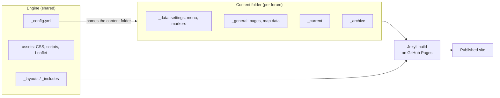

# Site design

Design reference for a Local Access Forum (LAF) website. It records how the site is structured and why, so that future maintainers — and other Local Access Forums reusing this repo — can understand it.

## Demo status

The site is currently a **demo**, hosted on a personal GitHub account. To avoid confusing visitors, it must not use the name of any real forum. The published site name is:

> **Demo Site for a Local Access Forum - Work in Progress**

The map uses real Essex rights-of-way data. People, places and projects are fictional, with names taken from Jane Austen's *Pride and Prejudice*, so that it is obvious they are not real.

## Scope

The site focuses on **projects and resources**. Member lists and meeting minutes are deliberately left out because they already have an online home elsewhere (decided at initial discussion, November 2026). The site holds:

- **Projects**, with updates and a map
- **How-to guides**
- **A glossary**
- **Resources**: links to other organisations' information, including online maps

## Goals

| Goal | How the design meets it |
|---|---|
| Maintainable without web skills | Content is Markdown and YAML; no build tools; editable in GitHub's web editor |
| Reusable by other LAFs | All forum-specific material lives in one content folder; fork the repo, replace that folder |
| Survives changes of maintainer | Repo can move from a personal account to an organisation account with no code changes |
| Keeps a public record | Closed projects are archived, not deleted |
| Map-centred | Projects can be given an area and found on a county-wide rights-of-way map |
| Accessible | Targets WCAG 2.2 AA; includes an accessibility statement |

## Platform

- **Hosting:** GitHub Pages, using its **built-in Jekyll build** (Jekyll 3.10). No GitHub Actions workflow, no npm, no custom plugins.
- **Plugins:** only `jekyll-sitemap` (for `sitemap.xml`), which GitHub Pages allows by default.
- **Map:** [Leaflet](https://leafletjs.com/) 1.9.4, stored in the repo (`assets/vendor/leaflet/`) so the site does not depend on a CDN. OpenStreetMap base tiles; no API key.
- **Editing:** GitHub's web editor, or clone / edit / push. No CMS.
- **Not published:** `docs/` and every `README.md` file are excluded from the built site.

## Engine and content

The repo is split into two parts:

- **The engine** (repo root): `_layouts/`, `_includes/`, `assets/` and `_config.yml`. Identical for every forum. Engine code never contains forum-specific names, text, or coordinates.
- **A content folder** (currently `demo_content/`): everything specific to one forum, including site settings, pages, projects, guides, glossary, resources and map data.



### Switching content folders

The repo can hold more than one content folder — for example `demo_content/` alongside a real `content/` — and publish whichever one `_config.yml` names. Only the named folder is published; nothing from any other content folder reaches the site.

To switch, change the folder name on both of these lines in `_config.yml`:

```yaml
collections_dir: demo_content
data_dir: demo_content/_data
```

This is useful while the site is being designed with the wider forum: the demo stays available for comparison while real content is built up.

The repo ships with a blank starter folder, `content/`, alongside the demo. Its example guide, project and update contain `published: false`, so they serve as copyable templates but never appear on the site. Engine pages show a short message ("No guides have been added yet") wherever a list is empty, and the map works without rights-of-way data. See `docs/getting-started.md`.

Two rules keep this working:

- Everything in a content folder lives in a sub-folder whose name starts with `_`. Jekyll ignores such folders unless they belong to the active content folder.
- Nothing in the engine refers to a content folder by name. Front-matter defaults in `_config.yml` use the pattern `*/_*/guides` etc., which matches whichever folder is active.

### Reuse by other forums

- **Now:** the repo is marked as a GitHub *template repository*. Another forum clicks "Use this template", fills in the starter `content/` folder, and changes the two lines above. `docs/getting-started.md` walks through this.
- **Later (optional):** the engine can be split into its own repo and consumed as a Jekyll `remote_theme`, so engine improvements reach every forum automatically. Keeping the engine/content boundary clean now makes this a small change.

## Content structure

The rule throughout is **one thing, one folder**: each project and each guide is a folder containing its Markdown and all of its images and files.

```
demo_content/
├── _data/
│   ├── site.yml              # forum name, area, contact email, demo banner, map settings
│   ├── navigation.yml        # main menu and footer links
│   ├── markers.yml           # general markers for the main map
│   ├── glossary.yml          # glossary terms and definitions
│   └── resources.yml         # links to other organisations, in groups
├── _general/                 # stand-alone pages, published at /<name>/
│   ├── home.md               # home page (permalink: /)
│   ├── about.md
│   ├── guides.md             # intro text; the list is generated
│   ├── glossary.md           # intro text; the A-Z list is generated
│   ├── resources.md          # intro text; the groups are generated
│   ├── projects.md           # intro text; the feed and list are generated
│   ├── map.md                # intro text; the map is generated
│   ├── contact.md
│   ├── accessibility.md
│   ├── sitemap.md
│   └── map/
│       ├── rights-of-way.geojson
│       └── README.md         # data source, licence, processing
├── _current/
│   ├── guides/
│   │   └── report-a-path-problem/
│   │       ├── index.md
│   │       └── photo.jpg     # images sit alongside
│   └── projects/
│       └── longbourn-footpath-survey/
│           ├── index.md      # project landing page
│           ├── background.md # any number of further pages
│           ├── results.md
│           ├── area.geojson  # optional: puts the project on the map
│           ├── updates/
│           │   └── 2026-10-05-first-repairs.md
│           ├── images/
│           └── files/
└── _archive/
    └── projects/             # same structure as _current
```

Pages such as Guides and Map are content files that choose an engine layout (`layout: guides`, `layout: map`). The content supplies the title and introduction; the engine supplies the generated list or map. A forum can therefore reword, rename, or drop any page without touching the engine.

### Current and archive

- `_current` and `_archive` have identical structures. Archiving something means **moving its folder** from one to the other.
- The folder location is the only record of status — there is no `status` or `current` field to keep in sync.
- **Web addresses do not change when a folder is archived.** Both `_current/projects/river-path/` and `_archive/projects/river-path/` publish to `/projects/river-path/`, so links from elsewhere keep working.
- The leading underscore is required by Jekyll to recognise these folders as content collections.

### Web addresses and links

Each Markdown file in `_current` or `_archive` is published as an `.html` file in the same web folder as its siblings:

| Source | Published at |
|---|---|
| `_current/projects/river-path/index.md` | `/projects/river-path/` |
| `_current/projects/river-path/history.md` | `/projects/river-path/history.html` |
| `_current/projects/river-path/images/bridge.jpg` | `/projects/river-path/images/bridge.jpg` |

Because every page of a project shares one folder, plain relative Markdown links work everywhere:

```markdown

[Download the survey report (PDF)](files/survey-report.pdf)
[Read the history of the path](history.md)
```

Links to another page of the same project can use its `.md` file name. This works when previewing the file on GitHub, and a small script (`assets/js/site.js`) changes it to `.html` on the site.

Links to other parts of the site are written from the root, such as `[our guides](/guides/)`. While the site is served from a sub-folder (for example `username.github.io/repo/`), the same script adds the sub-folder to these links. On a custom domain it does nothing.

Configuration (verified on Jekyll 3.10):

```yaml
collections:
  general: { output: true, permalink: "/:path/" }
  current: { output: true, permalink: "/:path:output_ext" }
  archive: { output: true, permalink: "/:path:output_ext" }
```

The stand-alone pages are a collection called `general` rather than `pages`, because a collection named `pages` would replace Jekyll's own list of pages.

## Pages

| Page | Generated from | Behaviour |
|---|---|---|
| Home | `_general/home.md` | Introduction, latest three project updates, links to guides, glossary and resources |
| About, Contact | `_general/` | Plain Markdown |
| Guides | `_current/guides/` | Alphabetical list of how-to guides, each linking to its own page |
| Glossary | `_data/glossary.yml` | Terms A to Z with a letter index |
| Resources | `_data/resources.yml` | Grouped links to other organisations' maps and information |
| Projects | `_current/projects/`, `_archive/projects/` | News feed of all project updates (newest first, each linking to its project), plus lists of active and completed projects |
| Project landing | `projects/<name>/index.md` | Summary, status, map (if it has an area or markers), its updates, and a list of its pages |
| Map | all projects, `_data/markers.yml` | County map with rights of way, project areas and markers, and a searchable project list |
| Accessibility | `_general/accessibility.md` | Accessibility statement |
| Sitemap | everything | Human-readable list of all pages; `sitemap.xml` generated for search engines |

### Guides

Each guide is a folder in `_current/guides/` containing `index.md` and any images. Front matter:

```yaml
---
title: How to report a problem on a path
summary: One sentence shown in the list of guides.
---
```

The Guides page lists every guide alphabetically by title.

### Glossary

`_data/glossary.yml` is a list of `term` and `definition` entries. The Glossary page sorts them A to Z, groups them by letter, and gives each term an anchor (`/glossary/#footpath`) so other pages can link to it. A single file suits this content: entries are short and rarely need their own media.

### Resources

`_data/resources.yml` is a list of groups, each with a `title`, optional `intro`, and `items` (`name`, `url`, optional `provider` and `description`). Groups include "Online maps" run by other organisations. External links are not checked automatically, so they need an occasional manual check.

### Projects

Landing page (`index.md`) front matter:

```yaml
---
title: Meryton Bridleway Link
summary: One-sentence description used in lists and map popups.
started: "2025-11"
ended:                 # set when archived
markers:               # optional, project-specific map markers
  - name: Busy road crossing
    lat: 51.70568
    lng: 0.58129
    description: Riders currently have to use the road here.
---
```

- **Further pages:** any other `.md` file in the project folder becomes a page of that project. It needs a `title`, and optionally an `order` number to set its position in the project's page list.
- **Updates:** each file in `updates/` is a short news item with a `title` and `date`. Updates appear on the project page, on the Projects page feed, and on the home page.
- **Active vs completed:** a project in `_current` is active; moving it to `_archive` marks it as completed. Completed projects remain visible and searchable, shown in grey with a dashed outline on maps.
- **Map:** shown automatically on the landing page if the project has an `area.geojson` or `markers`. Set `map: false` to hide it. Other pages of the project can show it with ``.

## Map

### Data

- **Base map:** OpenStreetMap tiles via Leaflet. OpenStreetMap's tile usage policy allows this for low-traffic sites with attribution.
- **Rights of way:** Essex County Council publishes its [Public Rights of Way GIS data](https://data.essex.gov.uk/dataset/em40y/public-rights-of-way-gis-data) under the Open Government Licence v3.0, as MapInfo files in British National Grid, updated quarterly.
- **Pre-processing:** the data is reprojected to WGS 84 and simplified to a 2 m tolerance, giving a single 4.7 MB GeoJSON file (about 0.8 MB as served, since GitHub Pages compresses it). This is small enough that vector tiles (PMTiles) are not needed. Source, licence, and processing details are in `_general/map/README.md`. Refreshing the data is an occasional task, not a routine maintainer task.
- **Attribution:** OSM, Essex County Council and the OGL statement (linked) are shown on every map, with an Ordnance Survey credit that is still to be confirmed. The key states that the data is not the legal Definitive Map. Full details of every third-party component and its licence are in `docs/credits-and-licences.md`.

### How the maps work

At build time Jekyll generates `assets/data/projects.json`, listing each project's name, summary, status, address, area file and markers. `assets/js/map.js` reads it to draw both kinds of map.

**Main map** (`layout: map`):

- Rights of way styled by type (footpath, bridleway, restricted byway, byway open to all traffic). Lines are thin and solid when zoomed out and become thicker and dashed when zoomed in, so project areas stand out at county scale. Clicking a line shows its type, number and parish.
- All project areas and markers; clicking an area shows a popup linking to the project.
- General markers from `_data/markers.yml`.
- A layers button to show or hide each type of route, active projects, completed projects and general markers.
- A project list beside the map, with a search box and "Show on map" buttons that zoom to each project. The list also gives access to every project without using the map.

**Project maps** (``) show one project's area and markers over the rights of way, zoomed to fit.

### Drawing an area

1. Open [geojson.io](https://geojson.io/) and draw the area.
2. Save as `area.geojson`.
3. Add the file to the project folder.

The project then appears on the main map and its own map automatically.

## Moving to an organisation account

- All engine links use Jekyll's `relative_url` filter, so the site works at `username.github.io/repo/`, `org.github.io/repo/`, or a custom domain. GitHub Pages sets the base address automatically; check links after the first deploy.
- Moving the repo: transfer it in GitHub settings, then re-enable Pages on the new repo if needed.
- A custom domain needs a `CNAME` file and a DNS record.
- The repo name forms part of the address until a custom domain is set, so it should not include a real forum's name while the site is a demo.

## Decisions

| Decision | Choice |
|---|---|
| Static site generator | Jekyll, GitHub Pages built-in build |
| Editing | GitHub web editor, or clone and push; no CMS |
| Media location | Alongside the content it belongs to |
| Status tracking | Folder location (`_current` / `_archive`) |
| Members and meetings | Not on this site; they already have an online home elsewhere |
| Glossary and resources | Single data files, not one folder per entry |
| Content folder | Selectable in `_config.yml`; currently `demo_content/` |
| Map library | Leaflet 1.9.4, stored in the repo, with OpenStreetMap tiles |
| Rights-of-way source | Essex County Council open data (OGL v3), served as a single simplified GeoJSON |
| Site name during demo | "Demo Site for a Local Access Forum - Work in Progress"; no real forum name used |
| Demo names | Characters and places from *Pride and Prejudice* |
